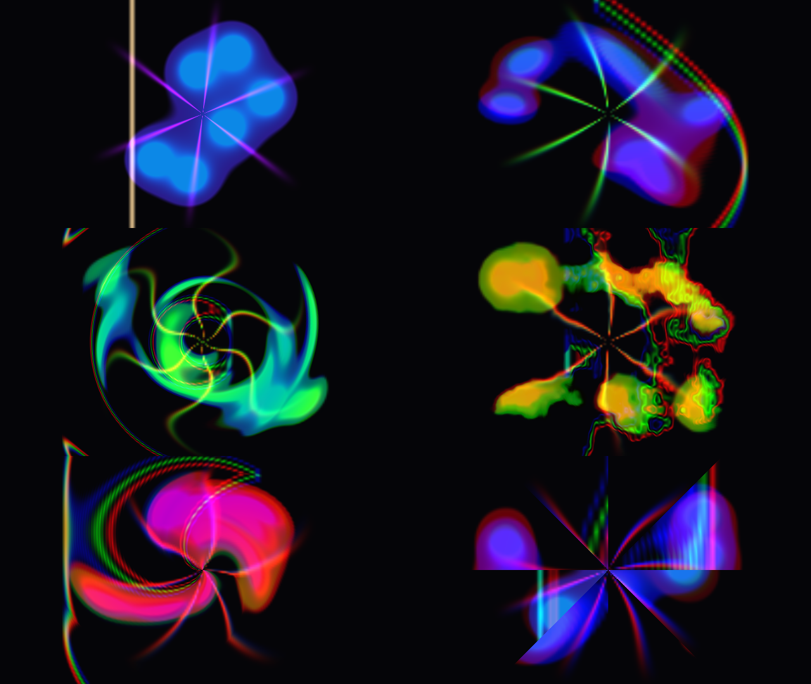

# Zaman Aynası

Kameradaki her pikselin **farklı bir zamandan** geldiği bir TouchDesigner efekti.
Son ~2 saniyenin kareleri GPU'da saklanır ve her piksel bir "gecikme haritasına"
göre geçmişten okunur. Hareket eden bir insan; eriyen, kıvrılan, dilimlere ayrılan
bir şekle dönüşür. R/G/B kanalları ayrı gecikmelerle okunduğu için hareketin
kenarlarında renk kayması oluşur.



Sol üstteki kare canlı görüntü, diğerleri sırasıyla Tarama, Halkalar, Sıvı, Spiral
ve Dilimler modları. Demo kaynağıyla çekilmiş 10 saniyelik önizleme:
[`onizleme/demo.mp4`](onizleme/demo.mp4)

## Kurulum (1 dakika)

1. TouchDesigner'da `/project1` içine bir **Text DAT** ekle.
2. `build_zaman_aynasi.py` dosyasının tamamını içine yapıştır.
3. Text DAT'a sağ tıkla → **Run Script**.
4. `/project1/zaman_aynasi` kurulur. Textport'ta `Zaman Aynası: {'ok': True, ...}`
   satırını görmelisin. `missing_params` listesi boş değilse, o parametre adları
   senin TD sürümünde farklıdır. Listeyi bana gönderirsen düzeltirim.

Betiği tekrar çalıştırmak güvenli: eski ağı silip yeniden kurar.

## Kontroller

`zaman_aynasi` Base COMP'u seç → parametre penceresinde **Zaman** sayfası:

| Parametre | Ne yapar |
|---|---|
| Kaynak | Demo (test animasyonu) veya Kamera |
| Mod | Tarama, Halkalar, Sıvı, Spiral, Dilimler |
| Otomatik geçiş | Açıkken modlar arasında yumuşakça kendi geçer |
| Geçiş hızı | Otomatik geçişin hızı |
| Derinlik | Ne kadar geçmişe gidileceği (1 = tüm tampon) |
| Renk kayması | R ve B kanallarının kaç kare önde/geride okunacağı |
| Karışım | 0 = canlı görüntü, 1 = tam efekt |
| Kayıt aralığı | Kaç karede bir kayıt alınacağı. 2 → 60 fps'de ~2 sn hafıza |

## Ağ yapısı

```
demo ─┐
      ├─ kaynak (switch) ─ null_kaynak ─┬──────────────────────┐
kamera┘                                 │                      │
atlas_baslangic ─ atlas_feedback ─ yaz ─┴─ null_atlas ─ oku ─ null_out ─ out1
                        ↑______________________│
```

- **yaz**: 8×8 karoluk atlasta (3200×1800) sırası gelen karoya canlı kareyi yazar.
  Diğer karoları feedback'ten aynen taşır. Böylece 64 karelik bir halka tampon oluşur.
- **oku**: her piksel için gecikmeyi hesaplar, iki kare arasında yumuşak geçiş yaparak
  atlastan okur.

Hepsi GLSL TOP ve Feedback TOP. NVIDIA'ya özel bir şey kullanmadığı için ofisteki
Intel iGPU'da 1280×720 çalışması beklenir. Ev PC'sinde (RTX) betiğin başındaki
`OUT_W/OUT_H` değerini 1920×1080, `TILE_W/TILE_H` değerini 480×270 yapabilirsin.

## Kamera (Sony A6700)

- Kamerada MENU → Setup → USB → USB Connection Mode = **USB Streaming**, çıkış 1080p 60p.
- `kamera` (Video Device In TOP) içinde cihaz olarak Sony'yi seç, Kaynak = Kamera.
- Titreme olmaması için manuel pozlama, manuel beyaz dengesi ve sabit odak kullan.
  Enstantaneyi şebekeye eşle (Türkiye'de 1/50 veya 1/100).

## Paylaşım için çekim önerileri

- **Hareket her şeydir.** Yavaş bir dönüş, saç savurma, kollar açılırken Halkalar
  ve Spiral modları en çok etkiyi yapar. Hızlı hareket Tarama modunda "eriyen" bir
  görüntü verir.
- **Arka plan koyu ve sade olsun.** Efekt hareket eden şeyin üzerinde çalışır.
  Karışık bir arka plan görüntüyü bulandırır.
- **Önce/sonra:** İlk 2 saniye `Karışım = 0` (normal görüntü), sonra 1'e çek.
  Bunu bir LFO veya Timer CHOP'a bağlayabilirsin.
- **Kayıt:** `null_out` → **Movie File Out TOP** (H.264, 1080×1920 dikey için
  `oku` çözünürlüğünü 1080×1920 yap) → Record.
